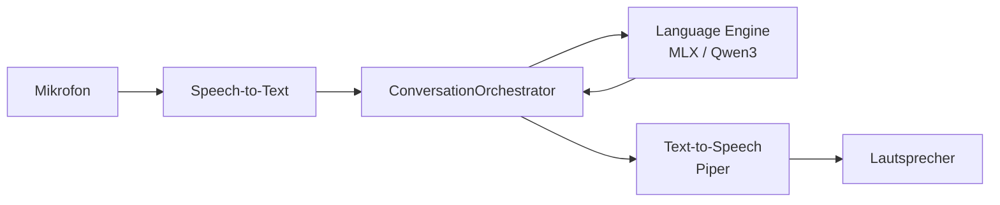

# Voicefinder

**Voicefinder** ist eine native iOS-App für natürliche, deutschsprachige Gespräche – fast vollständig **on-device**, ohne Cloud-Pflicht. Du sprichst, die App hört zu, denkt lokal nach und antwortet mit einer echten Stimme.

> Mikrofon → Spracherkennung → lokales Sprachmodell → Sprachausgabe

---

## Was Voicefinder ausmacht

Voicefinder fühlt sich eher wie ein **Telefonat** an als wie ein klassischer Sprachassistent. Die KI antwortet kurz und auf Deutsch, kann einen **Charakter**, einen **Auftrag** und ein **KI-Gehirn** (Nutzerprofil) mitbringen – und bleibt dabei modular, testbar und datensparsam.

**Kernidee:** Alles Wichtige läuft auf dem iPhone. Kein Server-Zwang für STT, LLM oder TTS.

### Funktionen

- **Gespräch per Sprache** – Live-Transkription, Unterbrechungen, Mikrofon-Stummschaltung
- **Lokales Sprachmodell** – [Qwen3-1.7B](https://huggingface.co/Qwen/Qwen3-1.7B) (4-Bit, MLX) fest im App-Bundle
- **Deutsche Sprachausgabe** – [Piper](https://github.com/rhasspy/piper) über Sherpa-ONNX, mehrere Stimmen (z. B. Thorsten, Kerstin, Eva)
- **Apple Speech** – bevorzugte STT-Engine auf dem Gerät (WhisperKit als Simulator-Fallback)
- **KI-Eigenschaften** – Name, Auftrag, Charakter-Prompt, Antwort-Stil (Normal, Forsch, Frech, Lustig, Schlau)
- **KI-Gehirn** – lokales Nutzerprofil, das sich im Gespräch ergänzt
- **Gesprächseröffnung** – optional mit Auftrag oder lockerem Einstieg
- **Open-Source-Transparenz** – Lizenzen und Quellen direkt in der App

---

## Architektur

Die Pipeline ist bewusst **protokollbasiert** aufgebaut: STT, Language Engine und TTS sind austauschbar, der `ConversationOrchestrator` hält den Gesprächszustand explizit.



| Schicht | Technologie | Rolle |
|--------|-------------|--------|
| **UI** | SwiftUI | Leichte Views, ViewModels, Einstellungen |
| **Orchestrierung** | `ConversationOrchestrator` | Turn-State, Pipeline, Unterbrechungen |
| **STT** | Apple Speech, WhisperKit | Partielle & finale Transkripte |
| **LLM** | MLX Swift, Qwen3-1.7B-4bit | Deutsche Antworten on-device |
| **TTS** | Piper + Sherpa-ONNX | Natürliche deutsche Stimmen |
| **Speicher** | UserDefaults, KI-Gehirn | Charakter, Profil, Einstellungen |

---

## Datenschutz & Lokales Processing

- **Spracheingabe** wird primär mit Apple Speech on-device verarbeitet
- **Antworten** entstehen lokal über MLX – kein API-Key nötig
- **Sprachausgabe** läuft über eingebettete Piper-Modelle
- **KI-Gehirn & Einstellungen** bleiben auf dem Gerät

Optional kann Internet-Recherche für faktische Fragen aktiviert werden; der Standardpfad ist offline-first.

---

## Voraussetzungen

- **Xcode** (aktuelle Version empfohlen)
- **iPhone mit Apple Silicon** (A12 oder neuer) für MLX & Live-STT
- Ausreichend Speicher für eingebettete Modelle (~1 GB LLM + Piper-Stimmen)

> Der **Intel-Simulator** unterstützt kein MLX-LLM; dort greifen Regel-Engine und WhisperKit als Fallback.

---

## Projekt einrichten

```bash
git clone <repository-url>
cd Voicefinder
```

### 1. Sprachmodell (MLX)

```bash
chmod +x Scripts/setup-llm-bundle.sh
./Scripts/setup-llm-bundle.sh
./Scripts/verify-embedded-llm.sh
```

Modell: `Resources/Models/qwen3-1.7B-4bit`

### 2. Piper-Stimmen (TTS)

```bash
chmod +x Scripts/setup-piper-german.sh Scripts/verify-embedded-piper.sh
./Scripts/setup-piper-german.sh
./Scripts/verify-embedded-piper.sh
```

Stimmen: `Resources/Models/piper-de/voices/`

### 3. In Xcode bauen

1. `Voicefinder.xcodeproj` öffnen
2. Team & Signing setzen
3. Auf **echtes iPhone** deployen (empfohlen für beste Qualität)
4. Mikrofon-Berechtigung erlauben

### MLX / Xcode 26: Metal-Warnungen `constexpr if`

Unter Xcode 26 kann das Swift-Paket **Cmlx** (MLX) harmlose Metal-Warnungen zu C++17 ausgeben. Das Projekt patcht das automatisch **vor jedem Build** (Scheme Pre-Action + `Scripts/patch-mlx-metal-warnings.sh`).

Nach **Reset Package Caches** oder neuem Clone einmal ausführen:

```bash
./Scripts/reset-spm.sh
```

---

## Projektstruktur

```
Voicefinder/
├── App/                    # Dependency Injection, Bootstrap
├── Core/
│   ├── Conversation/       # Orchestrator, Turn-State
│   ├── Language/           # MLX, Prompts, Sanitizer
│   ├── SpeechToText/       # Apple Speech, WhisperKit
│   ├── TextToSpeech/       # Piper-Engine
│   └── Memory/             # KI-Gehirn, Nutzerprofil
├── Features/
│   ├── Conversation/       # Haupt-UI & ViewModel
│   └── Settings/           # KI-Eigenschaften, Lizenzen
├── Resources/Models/       # Eingebettete ONNX/MLX-Modelle
├── Scripts/                # Setup & Verifikation
└── Tests/
```

---

## Open Source

Voicefinder baut auf großartiger Open-Source-Arbeit auf, u. a.:

- [Qwen3](https://huggingface.co/Qwen/Qwen3-1.7B) · Apache 2.0
- [MLX Swift](https://github.com/ml-explore/mlx-swift) · MIT
- [WhisperKit](https://github.com/argmaxinc/WhisperKit) · MIT
- [Piper](https://github.com/rhasspy/piper) · MIT
- [Sherpa-ONNX](https://github.com/k2-fsa/sherpa-onnx) · Apache 2.0

Eine vollständige Liste mit Links findest du in der App unter **Einstellungen → Open Source**.

---

## Status

Voicefinder ist ein **aktives MVP**: die Voice-Pipeline steht, die Gesprächsqualität wird laufend verbessert (Prompts, Latenz, Dedupe, Speicher-Management). Feedback und Issues sind willkommen.

---

## Autor

Entwickelt von **Markus Ringe** – eine experimentelle, privacy-first Voice-App für iOS.
